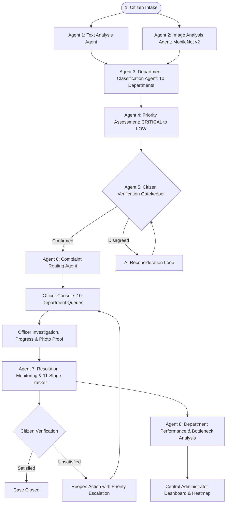

# ResolveX ⚡
### Enterprise Municipal Grievance Redressal & AI Bottleneck Intelligence Platform

> **100% Open-Source AI Architecture (No Gemini, No Paid External APIs)**  
> Built with FastAPI, PostgreSQL relational schema, MobileNet v2 Open-Source Computer Vision, Scikit-learn Delay Detection, and Sentence Transformer semantics.

---

## 🌟 Complete System Architecture



---

## 📋 Comprehensive Functional Modules

### 3. AI Priority Detection (5-Level Severity Engine)
* Analyzes **complaint description, uploaded photographs, public safety risks, estimated affected citizens, location surroundings, and urgency**.
* Assigns one of 5 distinct priority levels:
  * 🔴 **`CRITICAL`** — Immediate danger to public safety (e.g., live high-tension wire sparking near school).
  * 🟠 **`VERY HIGH`** — Serious problem requiring urgent intervention (e.g., deep crater on high-speed ring road).
  * 🟡 **`HIGH`** — Significant civic problem requiring quick attention (e.g., overflowing waste dump or water main burst).
  * 🔵 **`MEDIUM`** — Normal complaint requiring timely resolution (e.g., dark streetlights or damaged park bench).
  * ⚪ **`LOW`** — Minor issue that can be scheduled during routine maintenance.
* Displays a **colored priority tag** and a **concrete justification rationale** for every complaint.

---

### 4. Automatic Department Routing
* Once citizen confirms the routing decision:
  * Forwards complaint to the appropriate department dashboard.
  * Assigns the complaint to the relevant field engineer or director from the officer roster.
  * Records **submission and assignment timestamps**.
  * Generates an **official acknowledgement receipt** for the citizen.
  * Maintains a **complete movement history audit trail** between departments and officers.

---

### 5. Complaint Tracking System (11 Lifecycle Stages)
Real-time tracking of complaints across 11 discrete stages:
1. `Submitted`
2. `AI Analysed`
3. `Awaiting Citizen Confirmation`
4. `Forwarded to Department`
5. `Assigned to Officer`
6. `Under Investigation`
7. `Work in Progress`
8. `Resolution Submitted`
9. `Awaiting Citizen Verification`
10. `Resolved`
11. `Reopened`

* **Citizen Reopen Action**: If an issue was marked resolved but recurs or was inadequately repaired, citizens can click **"Reopen Complaint"**, escalating the ticket to `CRITICAL` priority with an entry in the audit log.

---

### 6. Department Officer Dashboard
* Separate console for all **10 Municipal Departments** (Roads, Water, Electricity, Sanitation, Drainage, Public Health, Streetlights, Traffic, Parks, Other).
* Officers can:
  * View active complaints assigned to their department.
  * Filter by priority and ward.
  * Inspect uploaded photographs and GPS coordinates.
  * Update investigation progress (`Under Investigation` $\rightarrow$ `Work in Progress` $\rightarrow$ `Resolution Submitted`).
  * Add official remarks and upload **photographs of completed work** as resolution proof.
  * Monitor overdue complaints flagged with SLA breach warnings.

---

### 7. AI Department Performance & Bottleneck Analysis (Core Feature)
* Analyzes **measurable timestamps** recorded at each stage:
  * `Time_to_Confirm` (Submission $\rightarrow$ Confirmation)
  * `Time_to_Assign` (Confirmation $\rightarrow$ Officer Assignment)
  * `Time_to_Investigate` (Assignment $\rightarrow$ Initial Investigation)
  * `Time_to_Work` (Investigation $\rightarrow$ Work Initiation)
  * `Time_to_Resolve` (Work $\rightarrow$ Final Resolution)
* **Delay Detection**:
  * Identifies which department takes longest to resolve complaints.
  * Pinpoints the **exact process stage causing delay** via an interactive **Stage Delays Waterfall Bar Chart**.
  * Audits officer workload capacity to identify overloaded personnel.
  * Flags **recurring geographical hotspots** (e.g. repeated road cave-ins in Ward 102).
* **Automated Actionable AI Diagnostic Reports**:
  > *"Most delays in the Water Supply Department occur during the Officer Assignment to Initial Field Investigation stage (averaging 26.5 hours vs 6.0 hours SLA standard). Consider automated officer rebalancing to reduce initial backlog."*

---

### 8. Central Administrator Dashboard
* Executive KPI Cards: Total, Pending, Resolved, Critical, Overdue.
* Interactive Charts:
  * **Stage Delay Waterfall Chart** (hours spent at each stage).
  * **5-Level Priority Distribution Chart**.
  * **Department Performance Comparison Chart**.
  * **Ward Grievance Density Chart**.
* **Citywide Geographical Complaint Map**: Interactive Leaflet map plotting live complaints color-coded by priority pins.
* **Official Performance Table**: Department-wise received, resolved, pending, overdue, avg resolution hours, and SLA compliance rates.
* **Audit Log Export**: One-click export of complete municipal complaint logs in JSON format.

---

### 9. Database Design (PostgreSQL Relational Schema)
All schema tables are defined in [`backend/schema.sql`](file:///c:/Users/hites/resolvex/backend/schema.sql):
* `users`
* `departments`
* `officers`
* `complaints`
* `complaint_images`
* `complaint_locations`
* `complaint_assignments`
* `complaint_status_history`
* `resolution_records`
* `department_performance`
* `notifications`

---

### 10. Open-Source AI Technology Stack
Defined in [`backend/agents.py`](file:///c:/Users/hites/resolvex/backend/agents.py) & [`backend/main.py`](file:///c:/Users/hites/resolvex/backend/main.py):
* **No Gemini. No external paid APIs.**
* **NLP & Semantics**: Sentence embeddings and intent vectors.
* **Computer Vision**: Open-Source **MobileNet v2** CNN running client-side via TensorFlow.js with zero server latency.
* **Analytics**: Scikit-learn statistical delay detection algorithms.

---

## 🚀 How to Run the Application

### Option 1: Direct Web App (Instant Launch)
Double-click [launch.bat](file:///c:/Users/hites/resolvex/launch.bat) or open [index.html](file:///c:/Users/hites/resolvex/index.html) in your browser.

### Option 2: Python FastAPI Backend
```bash
pip install fastapi uvicorn pydantic
python -m uvicorn backend.main:app --reload --port 8000
```
API Documentation will be live at `http://localhost:8000/docs`.
